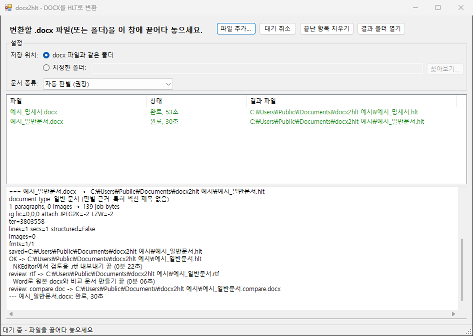

# docx2hlt

Word 문서(.docx)를 특허청 전자문서 작성기(NKEditor)에서 여는 .hlt 파일로 변환합니다.

## 필요한 것

- Windows
- NKEditor (`C:\KipoNet\NKEditor`에 설치)
- Microsoft Word (수식, 표, 비교 문서에 사용)

Python은 설치하지 않아도 됩니다. 배포 파일에 들어 있습니다.

## 설치

1. [Releases](../../releases/latest)에서 `docx2hlt-v*.zip`을 받습니다.
2. zip 파일 속성에서 "차단 해제"를 체크하고 원하는 폴더에 압축을 풉니다.

## 사용법

1. `docx2hlt_gui.exe`를 실행합니다.
2. 변환할 .docx 파일이나 폴더를 창에 끌어다 놓습니다.
3. 변환이 끝나면 .docx와 같은 폴더에 .hlt가 생깁니다.

- **저장 위치**: "지정한 폴더"를 고르면 .hlt를 그 폴더에 저장합니다.
- **문서 종류**: 보통 "자동 판별"로 둡니다. 국내 명세서, PCT 명세서(국문, 영문), 의견서, 일반 문서를 내용과 파일명으로 구분합니다.
- **이미지 자동 변환**: 켜 두면(기본) 도면, 수식, 표를 포함한 모든 그림을 1비트 300dpi G4 TIFF로 바꿉니다. 국내 출원에 컬러 그림을 넣으려면 끄세요. PCT는 흑백만 허용되므로 켜 두어야 합니다. 의견서의 그림은 바꾸지 않습니다.
- **검토 파일**: `.rtf`(NKEditor가 읽은 내용)와 `.compare.docx`(원본과 비교한 변경 추적 문서)가 함께 생깁니다.
- 변환 중에는 NKEditor와 Word가 자동으로 실행되었다가 닫힙니다. 끝날 때까지 기다리세요.

기술 설명(영문): [docs/TECHNICAL.md](docs/TECHNICAL.md)

## 라이선스

[MIT](LICENSE). 배포 파일에 들어 있는 Python과 Pillow는 각자의 라이선스(`python\LICENSE.txt`, `python\Lib\site-packages\pillow-*.dist-info\licenses\LICENSE`)를 따릅니다.
